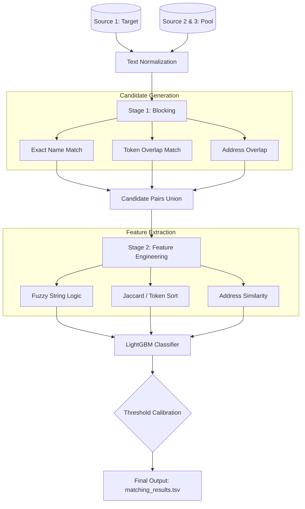

# Amazon ML Challenge 2026: Business Entity Resolution

## Overview
This repository contains our solution for the **Amazon ML Challenge 2026: Business Entity Resolution**. 

The goal of this project is to accurately link and merge business entities from a target dataset (`Source 1`) against a massive pool of 10M+ records (`Source 2` and `Source 3`). Because of the massive scale of the data, a simple pairwise comparison would result in trillions of calculations. To solve this, we implemented a highly scalable **Two-Stage Entity Resolution Pipeline** using heuristic blocking and a LightGBM classifier optimized for the **F0.5 metric** (a precision-heavy metric).

---

## Architectural Pipeline



---

## The Process

### 1. Data Preprocessing & Normalization
Before any matching occurs, all business names and addresses are passed through a strict normalizer. This process includes:
* Converting all text to lowercase.
* Stripping punctuation and special characters.
* Handling edge cases for `NaN` or missing values.

### 2. Stage 1: Blocking (Candidate Generation)
Comparing every company to every other company results in an $O(N^2)$ computational explosion. To reduce this, we use **Blocking**. Blocking groups highly likely matches together so the AI only evaluates realistic pairs.
We rely on three lightning-fast deterministic strategies:
* **Strategy 1 (Exact Match):** Direct hash lookups for identical normalized names.
* **Strategy 2 (Token Overlap):** Uses an inverted index to find pairs sharing a high percentage of name tokens (Jaccard $\ge$ 0.30), filtering out ultra-common words (like "LLC").
* **Strategy 3 (Address Blocking):** Matches based on shared ZIP/PIN codes and address tokens.

### 3. Stage 2: Feature Engineering (27 Features)
Once the candidate pairs are filtered down to a manageable size, we calculate 27 distinct pairwise similarity features to feed into the machine learning model.
* **Name Features (13):** `jaro_winkler`, `levenshtein_norm`, `token_sort_ratio`, `token_set_ratio`, `partial_ratio`, `WRatio`, `jaccard`, `overlap_coeff`, etc.
* **Address Features (11):** Similar fuzzy matching metrics applied strictly to the address strings, plus specialized logic for numeric matches and missing zip codes.

### 4. Machine Learning Training (LightGBM)
The 27 features are fed into a **LightGBM Binary Classifier**. 
* **Why LightGBM?** It is incredibly fast on CPU clusters, highly memory efficient, and natively handles tree-based tabular data perfectly. 
* The model evaluates every candidate pair and outputs a probability score between `0.0` and `1.0` indicating if they are the exact same business.

### 5. Threshold Calibration
Because the hackathon uses the **F0.5 Score** (which punishes False Positives twice as hard as False Negatives), we cannot simply use `0.50` as our cutoff. The pipeline runs a post-training calibration sweep to find the mathematically optimal threshold (e.g., `0.85`), maximizing our leaderboard score.

---


## AWS Cloud Scaling (EC2)
Because the dataset is massive (10M+ records), running the full pipeline on a standard laptop results in Out-Of-Memory (OOM) crashes. We successfully scaled this pipeline using **Amazon Web Services (AWS)**.

**Hardware Used:**
* **Instance Type:** `m5.16xlarge` (64 vCPU, 256GB RAM)
* **Storage:** 100GB EBS Volume
* **OS:** Ubuntu

**Cloud Setup & Execution:**
1. **Persistent Sessions:** Used `tmux` to ensure the training pipeline survived SSH disconnects during the multi-hour run.
2. **Data Transfer:** Synced the 3GB dataset securely from S3 to the EC2 instance using the `aws s3 sync` CLI and IAM roles.
3. **Thread Maximization:** Scaled the LightGBM hyper-parameters to utilize all `num_threads: 64` to maximize the 64-core enterprise CPU.

---
## How to Run

**1. Install Dependencies**
```bash
pip install -r requirements.txt
```

**2. Interactive Pipeline (Jupyter Notebook)**
If you want to view the pipeline block-by-block and execute it interactively, open:
```bash
jupyter notebook Entity_Resolution_Walkthrough.ipynb
```

**3. Command Line Execution**
Run the fast training sample (automatically splits into train/val):
```bash
python3 run_fast_train.py
```

Run the full prediction pipeline to generate your `matching_results.tsv`:
```bash
python3 run_predict_test.py
```
